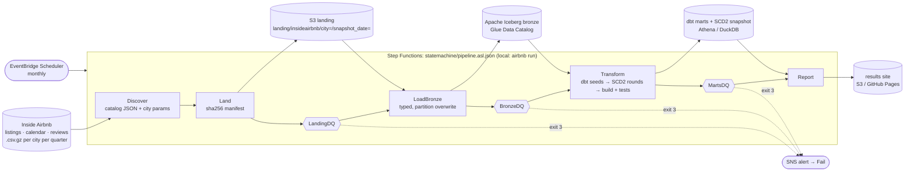

# Airbnb hosts, guests and rooms: an AWS batch lakehouse

[](https://github.com/rohit91jacob/airbnb-hosts-guests-aws/actions/workflows/ci.yml)
[](https://github.com/rohit91jacob/airbnb-hosts-guests-aws/actions/workflows/refresh.yml)
[](https://rohit91jacob.github.io/airbnb-hosts-guests-aws/)
[](LICENSE)
[](DATA_LICENSE.md)


A batch data pipeline for the short-term-rental market. It uses real quarterly snapshots from
[Inside Airbnb](https://insideairbnb.com/get-the-data/) for **Amsterdam, Austin and Singapore**,
two snapshots per city. It answers who hosts (single vs multi-listing, Superhosts), how busy
listings are (calendar availability and occupancy, ADR and revenue estimates), how prices and
attributes change between snapshots (SCD Type 2), what guests write (review velocity and a
simple lexicon sentiment), where supply sits (neighbourhoods), and how many listings show a
licence where cities require one.

* **AWS-shaped, emulated locally.** S3 landing zone → Apache Iceberg tables in a Glue-style
  catalog (pyiceberg) → dbt (DuckDB locally; an Athena target compiled in CI) → Step Functions
  state machine started by EventBridge Scheduler. The Terraform for all of it is validated
  (fmt, validate, tflint, checkov) but **was not applied to any AWS account**. Locally the same
  code runs against filesystem and SQLite stand-ins. In tests it runs against moto (S3, Glue,
  Step Functions, Scheduler, SNS, Athena), and a CI job runs it against LocalStack.
* **Real data, verified.** On the 9 October 2026 run, **45 of 45** headline figures on Inside
  Airbnb's own city dashboards match this build exactly: listing counts, room types, average
  nights booked, price and income, licence status, single/multi-listing hosts. The occupancy
  model reproduces Inside Airbnb's published per-listing estimate for **100%** of 49,692
  listing-snapshots. See [verification](docs/verification.md).
* **Production habits.** Idempotent, hash-skipping loads; partition-overwrite Iceberg writes;
  SCD2 history replayed in snapshot order on a pinned clock, so a rebuild from scratch equals the
  incremental history; data-quality gates between layers that stop the run (exit 3); one
  Step Functions definition that both the local runner and AWS execute.
* **Live results.** A monthly GitHub Actions job checks for new snapshots, reruns everything,
  re-reads the dashboards and publishes
  **[rohit91jacob.github.io/airbnb-hosts-guests-aws](https://rohit91jacob.github.io/airbnb-hosts-guests-aws/)**.
  It needs no credentials.

## Architecture



| Component | Code | What it does |
|---|---|---|
| Source discovery | `sources/insideairbnb.py` | Reads the Gatsby static-query JSON behind "Get the data" (572 free snapshots on 9 Oct 2026), and each city dashboard's `page-data` for model parameters (average stay, thresholds). Falls back to scraping HTML links. |
| Landing | `ingest.py`, `storage.py` | Streams each file to a temp file, proves the gzip is complete, records SHA-256, ETag and sizes, and writes the manifest last. Same keys on disk and on S3. Already-landed snapshots are skipped. |
| Bronze | `bronze.py`, `catalog.py` | DuckDB reads each CSV as text and projects a declared contract with `TRY_CAST`. Schema drift and cast failures go to `load_audit` rather than crashing. pyiceberg writes Iceberg with partition overwrites, using a SQLite catalog locally or Glue on AWS. Loads with an unchanged source hash are skipped. |
| Expose | `expose.py` | Pins each bronze table to its current Iceberg snapshot (`iceberg_scan(metadata.json)`) for one consistent dbt run. On AWS the DQ task reads the same tables from S3. |
| Transform | `transform.py`, `dbt/` | Seeds, then one dbt-snapshot round per snapshot date with the SCD2 clock pinned to that date (`macros/snapshot_time.sql`), then `dbt build` with 77 data tests. Only new rounds are applied. An out-of-order snapshot triggers a full replay. |
| Data quality | `quality/checks.py` | 4 landing, 16 bronze and 10 mart checks. Error-level failures exit 3 and stop the state machine. Results go to `ops.dq_results` and the site. |
| Orchestration | `orchestrate.py`, `infra/statemachine/pipeline.asl.json` | The local runner interprets the exact ASL file Terraform deploys: Task → Next, Catch → NotifyFailure → Fail. |
| Verification | `verify.py` | Headless Chrome renders the live dashboards. Their figures are parsed and compared with the marts, alongside the model vs published estimates and a reviews recount. |
| Results site | `report/` | A static HTML page and `summary.json`, with every number read from the warehouse. Publishes to S3 when `AIRBNB_SITE_BUCKET` is set. |
| AWS emulation | `aws/smoke.py` | Runs landing, Iceberg-on-Glue, the DQ-over-S3 path and the orchestration resources against moto or LocalStack. |
| Infrastructure | `infra/` | 10 Terraform modules: KMS, S3, Glue catalog, Athena workgroup, VPC, ECS Fargate + ECR, Step Functions + Scheduler + SNS, budget, GitHub OIDC deploy role, bucket baseline. |

## Tech stack

All Python versions are pinned in `uv.lock`; Terraform providers are pinned in `.terraform.lock.hcl`.

| Layer | Technology | Version |
|---|---|---|
| Language | Python | 3.12 |
| Table format | Apache Iceberg via pyiceberg (SQLite catalog locally, Glue on AWS) | pyiceberg 0.12.0 |
| Engine | DuckDB (+ `iceberg`, `httpfs` extensions) | 1.5.6 |
| Arrow | pyarrow | 26.0.0 |
| Transformations | dbt-core + dbt-duckdb (local/CI), dbt-athena (AWS target) | 1.12.5 / 1.11.0 / 1.11.1 |
| AWS SDK / emulator | boto3, moto (server mode), LocalStack (CI only) | 1.43.110 / 5.2.3 / 2026.09.1 |
| Infrastructure | Terraform, hashicorp/aws provider, tflint (+ aws ruleset), checkov | 1.16.5 / 6.68.0 / 0.64.0 (0.47.0) / 3.3.26 |
| Packaging & quality | uv, hatchling, ruff, pytest, pre-commit, gitleaks, Dependabot | ruff 0.16.10, pytest 9.1.1 |
| Site | Jinja2, inline SVG chart (no JS framework) | 3.1.6 |

## Data source

| | |
|---|---|
| Source | Inside Airbnb, <https://insideairbnb.com/get-the-data/>: `listings.csv.gz`, `calendar.csv.gz`, `reviews.csv.gz` per city per snapshot. Model parameters come from each city dashboard's page data. |
| Cities and snapshots in this build | Amsterdam 2026-06-15, 2026-09-16 · Austin 2026-06-22, 2026-09-17 · Singapore 2026-06-29, 2026-09-23 (set with `AIRBNB_CITIES`, `AIRBNB_SNAPSHOTS_PER_CITY`) |
| Volume (this build) | 332 MB landed (gzip); bronze 49,692 listing rows, 18,236,561 calendar nights, 1,271,388 reviews; 262 MB of Iceberg Parquet |
| Licence | [CC BY 4.0](https://creativecommons.org/licenses/by/4.0/). Inside Airbnb asks that the data not be republished, so **no Inside Airbnb rows are committed**. Fixtures are built from a download. See [DATA_LICENSE.md](DATA_LICENSE.md). |
| Refresh cadence | Inside Airbnb publishes each city about quarterly, on no fixed day, and keeps about 12 months free. The pipeline checks **monthly**. Unchanged snapshots cost one catalog request and no download. |
| Known gaps | `price` is a quote for one upcoming stay, not a list price. The calendar cannot separate booked from blocked nights. Reviews of delisted listings disappear from later files. Older snapshots need an archived-data request. `minimum_nights` is empty for 520 listing-snapshots (a warning-level check). |

## Data model

| Layer | Tables (grain) |
|---|---|
| Landing | three files + `_manifest.json` per city snapshot; city params; run plan |
| Bronze (Iceberg) | `listings` (listing × snapshot), `calendar` (listing × night × snapshot), `reviews` (review × listing), `snapshots`, `load_audit` |
| Staging / intermediate | `stg_iab__*`; `int_listing_snapshots` (occupancy model), `int_calendar_availability`, `int_hosts`, `int_review_sentiment` |
| Snapshot (SCD2) | `snap_listing_attributes`: 45,238 versions of 26,983 listings, 24,931 current |
| Marts | `fct_listing_snapshot`, `dim_listing`, `dim_city_snapshot`, `mart_city_snapshot_summary`, `mart_host_portfolio`, `mart_top_hosts`, `mart_occupancy_availability`, `mart_revenue_estimates`, `mart_price_change_history`, `mart_price_change_summary`, `mart_review_velocity`, `mart_guest_sentiment`, `mart_neighbourhood_supply`, `mart_licence_compliance` |
| Ops | `ops.dq_results`, `ops.scd2_rounds` |

Definitions and every column are in the **[data dictionary](docs/data_dictionary.md)**.

### Occupancy, ADR and revenue model (estimates)

This is Inside Airbnb's "San Francisco model"
([data assumptions](https://insideairbnb.com/data-assumptions/)), reproduced exactly:

* **bookings** in the last 12 months = `number_of_reviews_ltm` ÷ **0.5**. A 50% review rate is
  assumed, between the 72% and 30.5% used in San Francisco studies.
* **nights per booking** = the larger of `minimum_nights` and the city's **average length of
  stay** (Amsterdam 3.9; Austin and Singapore use the 3-night default).
* **nights booked** = bookings × nights per booking, **capped at 255** (70% of the year).
* **revenue** = nights × listed nightly price. **ADR** = revenue ÷ booked nights of listings
  with a price. **RevPAL** = revenue ÷ (priced listings × 365).

The calendar gives a second, independent view: the share of the next 30 nights not available.
That is an upper bound on bookings, because blocked nights look the same as booked ones.

## Results (9 October 2026 run, latest snapshot per city)

| | Amsterdam (2026-09-16) | Austin (2026-09-17) | Singapore (2026-09-23) |
|---|--:|--:|--:|
| Listings (change vs previous snapshot) | 10,612 (+2.3%) | 11,111 (−1.6%) | 3,208 (+3.6%) |
| Hosts | 9,231 | 5,507 | 761 |
| Single-listing hosts (share of hosts) | 93.5% | 74.3% | 54.4% |
| Listings run by multi-listing hosts | 18.7% | 63.2% | 87.1% |
| Superhosts (share of hosts) | 13.5% | 46.7% | 4.7% |
| Next 30 nights unavailable (calendar) | 80.7% | 52.0% | 34.5% |
| Est. occupancy (model) | 14.0% | 21.2% | 6.2% |
| Est. ADR (model) | €255 | $280 | S$197 |
| Median est. revenue per priced listing, 12 months | €10,643 | $10,758 | S$0 |
| Listings with no licence text | 4.4% | 67.9% | 45.9% |
| Priced listings whose price changed since the previous snapshot | 92.6% | 96.6% | 97.5% |

Singapore's median estimated revenue is 0 because most of its listings had no review in the last
12 months. The model infers bookings only from reviews. The "price changed" row mostly
reflects price quotes for different stay dates; see the limitations below. The site also has
neighbourhood supply, review velocity, lexicon sentiment, licence-rule flags and the
largest portfolios.

## Quickstart

### Prerequisites

* Python 3.12 and [uv](https://docs.astral.sh/uv/)
* Internet access to insideairbnb.com (about 330 MB for three cities × two snapshots)
* Optional: Terraform 1.9+ and tflint for `make infra-check`, and Chrome/Chromium for
  `make capture`. Docker is **not** needed locally.

```bash
git clone https://github.com/rohit91jacob/airbnb-hosts-guests-aws.git
cd airbnb-hosts-guests-aws
make install            # uv sync --frozen --all-groups + pre-commit hooks
cp .env.example .env    # optional: every setting has a default

make run                # live: discover -> land -> DQ -> bronze -> DQ -> dbt + SCD2 -> DQ -> report
open site/index.html    # (or start site/index.html on Windows)
make capture            # re-read the live dashboards and reconcile (headless Chrome)
make sql                # query the marts
```

On this machine (a Windows 11 laptop), the six snapshots took **79 s** to download and land.
The rest of the first run took **2 min 33 s**: 74 s for bronze, 61 s for dbt with six SCD2 rounds
and its tests, and seconds for each gate. A rerun with nothing new took **1 min 38 s**. All 18
bronze loads were skipped, no SCD2 round was applied, and dbt rebuilt and re-tested the marts
(PASS=102).

### Without hitting Inside Airbnb every time

```bash
make fixtures           # one download -> a 120-listings-per-city real sample (gitignored)
make fixtures-run       # whole pipeline on the sample, offline
make test               # unit + e2e + AWS-emulator tests
```

### Emulated AWS

```bash
make aws-smoke          # moto in-process: S3 landing, Iceberg on Glue + S3, DQ via DuckDB over S3,
                        # Step Functions definition, Scheduler schedule, SNS, Athena workgroup
AWS_ENDPOINT_URL=http://localhost:4566 uv run airbnb aws-smoke --catalog sql   # against LocalStack
make dbt-compile-athena # every model compiled for Athena (offline, dummy credentials)
make infra-check        # terraform fmt/validate, tflint, checkov
```

## Cloud mapping: local emulator → real service

| Concern | Local / CI (what actually ran) | AWS (Terraform, validated, not applied) |
|---|---|---|
| Landing zone | Filesystem laid out as `s3://<bucket>/<key>`; moto S3; LocalStack S3 | S3 bucket: SSE-KMS, versioning, access logs, lifecycle to IA, TLS-only |
| Table catalog | pyiceberg `SqlCatalog` (SQLite); moto Glue in tests | AWS Glue Data Catalog: one database for bronze and one per dbt schema |
| Table format | Apache Iceberg (Parquet + zstd) on disk or emulated S3 | Apache Iceberg on S3 |
| SQL engine | DuckDB via dbt-duckdb | Amazon Athena (engine v3) via dbt-athena, in a workgroup with an enforced 10 GiB per-query cutoff |
| Compute | `airbnb <step>` in-process | ECS Fargate task (one image, read-only root filesystem, non-root user) |
| Orchestration | `airbnb run` walks `pipeline.asl.json`; moto/LocalStack register it | AWS Step Functions (logging, X-Ray, KMS) |
| Schedule | GitHub Actions cron (monthly) | EventBridge Scheduler (monthly, KMS-encrypted) |
| Alerts | Failure issue opened by `refresh.yml` | SNS topic + `ExecutionsFailed` alarm |
| Results site | GitHub Pages | S3 site bucket (`AIRBNB_SITE_BUCKET`) |
| Secrets / auth | Dummy emulator credentials only | Task roles (least privilege), GitHub OIDC deploy role, no static keys |
| Cost guardrails | n/a | AWS Budget (80% actual / 100% forecast), Athena bytes-scanned cutoff + daily scan alarm |

## Testing and CI

| Suite | What it covers | Local result (9 Oct 2026) |
|---|---|---|
| `tests/unit` (28) | catalog parsing, landing integrity and idempotency, bronze typing, drift and reruns, every DQ check, state-machine routing, CLI exit codes, S3 publish (moto), Terraform ↔ ASL placeholders, verify's live-vs-stored capture reporting | 28 passed |
| `tests/e2e` (6) | whole state machine on the real sample; layer reconciliation; site numbers = marts; **rerun leaves every mart and the SCD2 table byte-identical**; full-refresh SCD2 = incremental; failed gate stops before bronze (exit 3) | 6 passed |
| `tests/aws` (1) | moto: S3 landing, Glue-registered Iceberg, DuckDB reading Iceberg from S3, idempotent reload, Step Functions + Scheduler + SNS + Athena workgroup | 1 passed |
| dbt | 77 data tests (uniqueness, bounds, accepted values, SCD2 integrity, cross-layer reconciliation) | PASS=102 on real data (2 seeds, 22 models, 1 snapshot, 77 tests) |

The full local run (`make test`) took 13 min 7 s on the development laptop: 35 passed, 84% line + branch coverage.

[`ci.yml`](.github/workflows/ci.yml) runs these jobs: lint (pre-commit: ruff, gitleaks,
`terraform fmt`, hygiene), unit tests, a fixture job (download once, cached by snapshot
fingerprint), pipeline + `dbt build` + e2e, dbt compile for Athena, AWS on moto, AWS on
LocalStack, Terraform (fmt, validate, tflint, checkov) and a Docker build. Every action is pinned to a
commit SHA. The LocalStack and Docker jobs cannot run on the development machine (no Docker
there), so they have only run in GitHub Actions, not locally. The LocalStack job needs a
`LOCALSTACK_AUTH_TOKEN` secret for current LocalStack images. Without one it skips with a
visible warning, and the moto job still covers the same code paths.

[`refresh.yml`](.github/workflows/refresh.yml) runs monthly, caches the lake between runs,
publishes the site to Pages and opens an issue on failure. [`keepalive.yml`](.github/workflows/keepalive.yml)
keeps the schedules enabled. [`deploy.yml`](.github/workflows/deploy.yml) is inert unless
`vars.AWS_DEPLOY_ROLE_ARN` is set. It then uses OIDC to push the image and register a new
task-definition revision.

## Cost notes

Nothing here has run on AWS, so these are **estimates from public list prices**, not bills.
For one monthly run of three cities: S3 holds under 1 GB (~$0.02), Fargate runs about 10 task
minutes at 2 vCPU / 8 GB (~$0.03), and Athena scans little. Bronze is 262 MB of Parquet, so even
a build reading every column several times scans a few GB (~$0.01 at $5/TB). Step Functions,
Scheduler and SNS stay inside their free tiers. The fixed costs are the KMS key ($1/month),
CloudWatch Logs and the short-lived public IPv4 addresses. Expect about **$1–3 a month**. The
budget defaults to $15 and alerts long before that. The VPC has no NAT gateway (about $32/month),
for that reason.

## Configuration

Every setting is an environment variable with a working default (`src/airbnb_lakehouse/config.py`,
documented in [`.env.example`](.env.example)). The main ones: `AIRBNB_DATA_DIR`, `AIRBNB_CITIES`,
`AIRBNB_SNAPSHOTS_PER_CITY`, `AIRBNB_SOURCE` (`insideairbnb` | `fixtures`), `AIRBNB_STORAGE`
(`local` | `s3`), `AIRBNB_CATALOG` (`sql` | `glue`), `AWS_ENDPOINT_URL` (emulators) and `DBT_TARGET`
(`dev` | `ci` | `athena`).

## Project structure

```
src/airbnb_lakehouse/
  sources/insideairbnb.py  catalog + dashboard parameters      ingest.py      landing + manifests
  bronze.py                typed Iceberg loads                  catalog.py     SQLite / Glue catalog
  expose.py                Iceberg -> DuckDB (pinned snapshots) transform.py   dbt + SCD2 replay
  quality/checks.py        gates (exit 3)                       orchestrate.py ASL interpreter
  verify.py                published-figure reconciliation      report/        results site
  aws/smoke.py             moto / LocalStack runs               cli.py         `airbnb` CLI
dbt/        staging -> intermediate -> marts, snapshots/ (SCD2), seeds/, tests/, macros/ (DuckDB + Athena)
infra/      main.tf + modules/{kms,storage,s3_bucket,catalog,athena,network,compute,orchestration,budget,github_oidc}
            statemachine/pipeline.asl.json (shared with the local runner)
tests/      unit/ (synthetic vectors)  e2e/ (real sample)  aws/ (moto, LocalStack)
docs/       data_dictionary.md  runbook.md  verification.md  verification/published_dashboards.json
```

## Design rationale

Five constraints shaped the design. The data is real and public, but Inside Airbnb asks that it
not be republished, so no rows are committed and the real-data fixtures are cut from a download.
The live refresh runs monthly on GitHub-hosted runners and needs no credentials. There is no AWS
account, so every AWS service needs a stand-in that runs the same code (filesystem and SQLite on
a laptop without Docker, moto in tests, LocalStack in CI), and the Terraform is validated, not
applied. The deployed shape has to stay cheap: the budget defaults to $15 a month. And rebuilds
have to be deterministic: a rebuild from scratch must reproduce the history built round by round.
The data is small (332 MB of gzip for six snapshots), so single-machine tools are enough.

### Architecture decisions

| Decision | Why | Alternatives considered | Trade-off accepted |
|---|---|---|---|
| **One state machine, two executors** (`infra/statemachine/pipeline.asl.json`, `orchestrate.py`) | Terraform deploys the ASL file through `templatefile()`, and `airbnb run` walks the same file, so step order and gates cannot drift between laptop, CI and cloud. A unit test fails if Terraform stops supplying a placeholder the file uses. | A local Makefile or script plus a cloud workflow kept in step by hand; running the definition in an emulator (moto registers it but does not run ECS tasks). | The local runner supports only Task, Succeed and Fail states and does not emulate `Retry`, so no test exercises retries or timeouts. |
| **Land files byte-for-byte, manifest last** (`ingest.py`, `storage.py`) | A snapshot counts as landed only once every gzip stream has been fully decompressed and its SHA-256, ETag and sizes recorded. Writes are atomic, so an interrupted run leaves nothing a later run would trust. Keys (`city=/snapshot_date=`) are the same on disk and on S3. | Converting to Parquet while downloading; trusting the HTTP status alone. | Raw and typed copies both exist (332 MB of gzip plus 262 MB of Iceberg Parquet). Files are assumed immutable per date; `airbnb ingest --force` re-downloads if that ever breaks. |
| **Bronze is a declared contract** (`bronze.py`) | DuckDB reads each CSV as text and projects declared columns with `TRY_CAST`. Inside Airbnb adds and renames columns over time, so drift and cast failures go to `load_audit` and the gates instead of crashing a load or dropping rows. `price` stays raw text and is parsed in dbt, where a test covers the rule. | Type inference (`read_csv_auto`, `union_by_name`); strict casts that fail the load. | A new source column is ignored until someone declares it (it shows up in `extra_columns`), and the column lists are kept by hand. |
| **Iceberg written by pyiceberg, read by DuckDB; no Spark** (`catalog.py`, `expose.py`) | Three cities fit easily on one machine, and on AWS in one Fargate task. Each `airbnb transform` reads views over `iceberg_scan('<metadata.json>')` pinned to the snapshot current when it starts, so a load that commits mid-run cannot change what dbt sees. The same tables register in SQLite locally and in Glue on AWS. | Spark on EMR or Glue; plain Parquet folders and a crawler; copying bronze into DuckDB (kept as the `AIRBNB_BRONZE_EXPOSE=table` fallback). | Writes are single-process and memory-bound: a city's calendar load needs about 4 GB (`infra/variables.tf`). Locally the marts are DuckDB tables; they become Iceberg only on Athena (`+table_type: iceberg`). |
| **Idempotent at every layer** | A rerun with nothing new leaves the data unchanged. Landed snapshots are skipped. A bronze load is skipped when its source SHA-256 matches `load_audit`, and a forced load is an Iceberg overwrite of exactly its `(city, snapshot_date)` partition (reviews: the city, because each file is cumulative). The e2e suite compares content hashes of the SCD2 table and 11 mart tables before and after a rerun. | Append-only loads with downstream dedupe; `MERGE` on business keys; truncate and reload. | Skipping trusts the source hash, so a changed load rule needs `airbnb bronze --force`. Only the newest reviews file is kept, so reviews of delisted listings disappear. |
| **SCD2 on a replay clock** (`transform.py`, `dbt/macros/snapshot_time.sql`) | dbt snapshots normally stamp "now". Each snapshot date is replayed as its own round with `snapshot_get_time()` overridden, so `valid_from` is the date Inside Airbnb observed the change and rebuilds are deterministic. `ops.scd2_rounds` records applied rounds: a rerun with nothing new applies none, and a snapshot older than the last applied round forces a full replay. Every other model is a view or a table rebuilt each run, so the snapshot is the only stateful model. | dbt's run-time clock; a hand-written SCD2 `MERGE`; incremental marts. | Every run rebuilds and re-tests all marts (the whole rerun with nothing new took 1 min 38 s on the development laptop). A backfill replays the whole history. Bedrooms, beds and bathrooms are carried but not tracked, because their scrape coverage swings between snapshots. |
| **Data-quality gates are states** (`quality/checks.py`) | 4 landing, 16 bronze and 10 mart checks sit between the layers, alongside dbt's 77 data tests. An error-level failure exits 3, fails the state and stops the run before the next layer is built or anything is published. Warnings are recorded and shown on the site. A check that fails to run counts as failed. | dbt tests only; a separate framework such as Great Expectations or Soda; alerting without blocking. | One failed gate blocks the whole run, site included. Warning thresholds, such as the 14-day scrape window and the 20% sentiment-signal floor, are hand-picked. |
| **Reconcile with the publisher's own figures** (`verify.py`) | Internal reconciliations prove that the layers agree, not that the numbers are right. Headless Chrome renders each live city dashboard, and its figures are compared with marts that reproduce the dashboard's conventions (`scope = 'dashboard_default'`, whole-unit prices in `dash_*`). | Internal checks only; comparing only with the per-listing `estimated_*` columns (kept as a second, independent check). | Parsing rendered text is brittle and needs Chrome. A failed capture falls back to the stored one, and the output says which. Matching Inside Airbnb's model does not validate the model. |
| **Respect the source** (`fixtures.py`) | Nothing is republished. The fixture sample is cut from a download (the 120 listings per city with the lowest md5 of their id) and cached in CI by snapshot fingerprint, and `ingest` skips files already landed. Reviewer names are dropped at bronze, and the site shows aggregates and ranks, never host names. | Committing a sample; synthetic data everywhere. | A cold cache or a fresh lake needs network access to insideairbnb.com. Unit tests use synthetic vectors, so among the tests only the e2e and AWS suites see real rows. |

### Stack choices

| Layer | Choice | Why this | Why not the alternatives |
|---|---|---|---|
| Language | Python 3.12 (`>=3.12,<3.13`) | Every library the pipeline needs (pyiceberg, DuckDB, dbt, boto3, moto) is Python, so each step is one process and dbt runs in-process through `dbtRunner`. The same minor version is pinned in `pyproject.toml`, `.python-version`, CI and the image. | A JVM language would only pay off with Spark, which this data size does not need. |
| Table format and catalog | Apache Iceberg via pyiceberg 0.12.0; SQLite `SqlCatalog` locally, AWS Glue Data Catalog on AWS | Atomic partition overwrites, snapshot pinning and additive schema evolution from plain Python. Athena and Glue support Iceberg natively and dbt-athena materialises it, so on AWS bronze and marts share one format. The SQLite catalog gives the same namespaces and metadata files as Glue, with no server. | Delta Lake: dbt-athena's SQL materialisations write Hive or Iceberg, not Delta. Plain Parquet: no atomic replace and no snapshot to pin. A REST catalog (Nessie, Polaris) or a Hive metastore: one more service on the laptop and in CI. |
| Engine | DuckDB 1.5.6 with the `iceberg` and `httpfs` extensions; pyarrow 26.0.0 | In-process and server-free: one engine reads the gzip CSVs, types bronze, runs the gates and backs dbt, on the laptop or in one task. `iceberg_scan` reads the tables from disk or S3, so on AWS the gates run the same SQL against Glue-registered tables without going through Athena. Arrow carries DuckDB results into pyiceberg. | Spark: a JVM and a cluster for data that fits on one machine (the largest table is 18.2 million calendar rows). pandas: no SQL to share with dbt and the gates. |
| Transformations | dbt-core 1.12.5; dbt-duckdb 1.11.0 (`dev`, `ci`), dbt-athena 1.11.1 (`athena`) | One tested SQL project with three targets (`dbt/profiles.yml`). A small dispatch layer (`dbt/macros/cross_db.sql`) covers DuckDB/Trino differences, `generate_schema_name` maps each schema to its own Glue database on Athena, and CI compiles every model for Athena offline. Dependabot leaves dbt-core and its adapters to deliberate bumps. | Hand-run SQL scripts: no DAG, tests or docs. Glue Spark jobs: Spark again, billed per DPU-hour, for data that fits on one machine. |
| Warehouse on AWS | Amazon Athena, engine version 3, in a workgroup with an enforced 10 GiB per-query cutoff | Serverless and billed by data scanned: the cost notes put a monthly build over 262 MB of Parquet at about a cent. It queries the Glue-registered Iceberg tables in place, and nothing runs between builds. | Redshift Serverless or a cluster: capacity to configure for one build a month. DuckDB in Fargate for the marts too: workable, but the marts would sit in a task-local file instead of Glue, where Athena and other tools can query them. |
| Orchestration | AWS Step Functions (Standard) started by EventBridge Scheduler; a GitHub Actions cron for the live refresh | One JSON file holds `ecs:runTask.sync`, `Retry`, `Catch` and the SNS failure path, and the local runner can interpret it. At one run a month it stays inside the free tier (cost notes). The scheduler adds a flexible window and its own retries. The free refresh walks the same definition on a GitHub runner. | Amazon MWAA (Airflow): an environment billed by the hour whether or not anything runs. Dagster or Prefect: another service to host. Cron on an EC2 instance: a server to patch. |
| Compute | ECS Fargate, 2 vCPU / 8 GB; one image (`python:3.12-slim-bookworm`, uv 0.10.2) | No idle compute cost and no servers. Every state runs the same image with a different `airbnb` sub-command, as a non-root user on a read-only root filesystem (both checked by the CI Docker job), with a 50 GiB scratch volume. Steps pass the run plan through S3 (`state/plan.json`). | Lambda: a 15-minute limit and a Lambda-specific image or zip. AWS Batch: queues and compute environments for one task at a time. EMR Serverless: a Spark runtime for data that fits in memory. |
| AWS SDK and emulators | boto3 1.43.110; moto 5.2.3 (server mode); LocalStack 2026.09.1 (CI only) | moto runs in-process with no Docker (the development laptop has none) and covers S3, Glue, Step Functions, Scheduler, SNS and Athena. LocalStack gives CI a second, independent emulator. `aws/smoke.py` always points boto3 at an emulator with dummy credentials. | Real AWS in CI: an account, credentials and a bill for every push. LocalStack alone: Docker locally and, for current images, an auth token. |
| Infrastructure as code | Terraform 1.16.5, hashicorp/aws 6.68.0, tflint 0.64.0 (aws ruleset 0.47.0), checkov 3.3.26 | Ten small modules under one root, with `infra/envs/dev.tfvars` and `infra/envs/prod.tfvars`. CI checks the whole stack without an AWS account: `fmt`, `validate` after `init -backend=false`, tflint, and checkov with every skip justified inline. `templatefile()` renders the shared ASL file. S3 state with native locking is one copy of `infra/backend.tf.example` away. | AWS CDK: Python bindings exist, but the CLI needs Node.js, and an offline check means synthesising CloudFormation first. |
| CI/CD and auth | GitHub Actions, every action pinned to a commit SHA; GitHub OIDC for the deploy role | Free for a public repository. The refresh needs no secrets: Inside Airbnb is public and Pages uses the built-in `GITHUB_TOKEN`. `deploy.yml` assumes an IAM role through OIDC that trusts only `main` and the `aws` environment, so no static AWS keys exist. | IAM user access keys in repository secrets: long-lived and in need of rotation. CodePipeline or CodeBuild: an AWS account before any CI could run. |
| Packaging and quality | uv (`uv.lock`), hatchling, ruff 0.16.10, pytest 9.1.1, pre-commit 4.6.2 (with gitleaks 8.30.1), Dependabot | `uv sync --frozen` installs exactly the locked versions on the laptop, in CI and in the image. ruff covers linting and formatting; pytest markers (`e2e`, `aws`) separate the slow suites; pre-commit runs the same hooks locally and in CI. | pip-tools or Poetry would also work; uv is much faster, and the same tool runs on the laptop, in CI (`setup-uv`) and in the Dockerfile. flake8, black and isort: three tools for what ruff does here. |
| Results site | Jinja2 3.1.6, inline CSS and SVG (`report/charts.py`); GitHub Pages, or S3 when `AIRBNB_SITE_BUCKET` is set | A static page and `summary.json`, with every number read from the warehouse at build time. No server and no build step, and it publishes unchanged to Pages or S3. | QuickSight, Superset or Metabase: a running service and logins for a page that changes once a month. A JavaScript charting library: a dependency and a bundle for one line chart. |
| Dashboard capture | The system Chrome, Chromium or Edge, run with `--headless=new --dump-dom` (`verify.py`) | The dashboards compute their figures in the browser. One subprocess call returns the rendered DOM without adding a Python dependency. | Playwright or Selenium: a driver package and a managed browser for one page per city. |

### What would change in production

* **A real account, and Athena executed.** Nothing here has been applied (see
  [Limitations](#limitations)). A first deployment would `terraform apply` the dev environment
  with the S3 backend, push the image through `deploy.yml` and run the state machine end to end
  before relying on the schedule. Medians there can differ slightly from the DuckDB build,
  because they compile to `approx_percentile` on Athena (`dbt/macros/cross_db.sql`).
* **Run state that survives a task.** Locally, and on the refresh runner, every step shares one
  data directory, so the DuckDB file and `state/` carry over between steps (and, through the
  cache, between runs). Each Fargate task starts with an empty scratch volume, so on AWS
  `airbnb transform` would need `bronze.snapshots` exposed from Glue before it lists rounds, the
  SCD2 ledger (`ops.scd2_rounds`) would move into the catalog, for example as a small Iceberg
  table, and `airbnb report` would read the plan and gate summaries from S3, where `discover`
  and `dq` already write copies.
* **The lake in S3, not in a cache.** `refresh.yml` keeps landing, Iceberg and the warehouse in
  an Actions cache between monthly runs. GitHub evicts caches that go unused; when nothing is
  restored, the run starts from a full download and the SCD2 history restarts from the snapshots
  in the current plan. The Terraform lake bucket (versioned, SSE-KMS, landing files moved to
  Infrequent Access after 30 days) is the durable home.
* **Retries and fan-out.** The deployed definition retries each task up to twice, with backoff,
  on ECS errors and timeouts; the local runner fails fast and supports no `Map` or `Parallel`
  state. Many more cities would fan landing and bronze out per city with a `Map` state, which the
  local runner would have to learn, instead of one task looping over every snapshot. Spark would
  only be worth it once a single city outgrew one 2 vCPU / 8 GB task.
* **A stricter network.** Tasks get a public IP in public subnets, with egress limited to TCP 443
  and an S3 gateway endpoint, because a NAT gateway alone costs about $32 a month. A production
  network would put them in private subnets behind a NAT gateway or an egress proxy, with
  interface endpoints for ECR, CloudWatch Logs, Glue and Athena.

## Limitations

* **Emulated, not deployed.** No AWS account was used. moto and LocalStack check API shapes and
  the data path, not IAM enforcement, service quotas or Athena's real SQL dialect. The Athena
  models are compiled, not executed.
* **Model, not bookings.** Occupancy, revenue and ADR are estimates. They reproduce Inside Airbnb's
  model exactly, but its assumptions (50% review rate, average stay, 70% cap) are not validated
  against real booking data, because none is public.
* **Price is a dated quote.** The listings `price` equals the per-night rate of
  `price_quote_total_price` for one stay. That stay is usually the minimum stay, starting a few
  days after the scrape (median 1–13 days here). Changes between snapshots therefore mix real
  repricing with seasonal and dynamic pricing. The SCD2 history records them faithfully but cannot
  tell the two apart. Singapore's median quoted price rose 59% between the June and September
  snapshots (S$127.53 to S$202.77 over all priced listings, with the same 6-night median quote
  length); among listings whose price changed, the median change was +53%. This build does not
  explain why.
* **Sentiment is a toy.** It counts 138 hand-picked English words with no negation handling, so
  non-English reviews mostly carry no signal. Over the last 12 months of reviews, 64% of
  Amsterdam's and Singapore's (and 94% of Austin's) carry one.
  It is a trend indicator, clearly labelled.
* **Licence flags are indicative.** The rules are simplified and cite their sources. Inside
  Airbnb's licence field shows whether *something* is filled in, not whether it is valid.
* **Two snapshots per city.** The free archive covers about 12 months. Longer histories need an
  archived-data request. The pipeline then backfills by replaying SCD2 from scratch.

## Operations

See the **[runbook](docs/runbook.md)** for exit codes, reruns, backfills, gate failures,
the scheduled refresh and the AWS deploy and rollback path.

## License

Code: [MIT](LICENSE). Data: Inside Airbnb, [CC BY 4.0](https://creativecommons.org/licenses/by/4.0/).
Attribution and the no-republishing policy are in [DATA_LICENSE.md](DATA_LICENSE.md). This project
has no connection to Airbnb, Inc. or Inside Airbnb.
